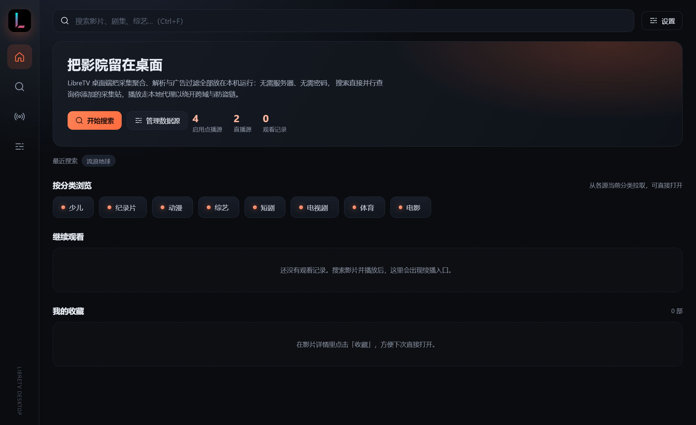
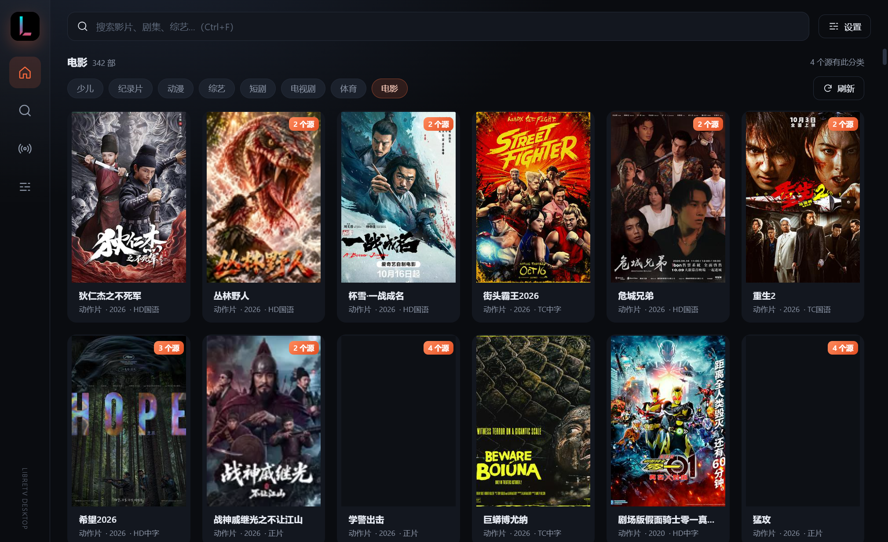
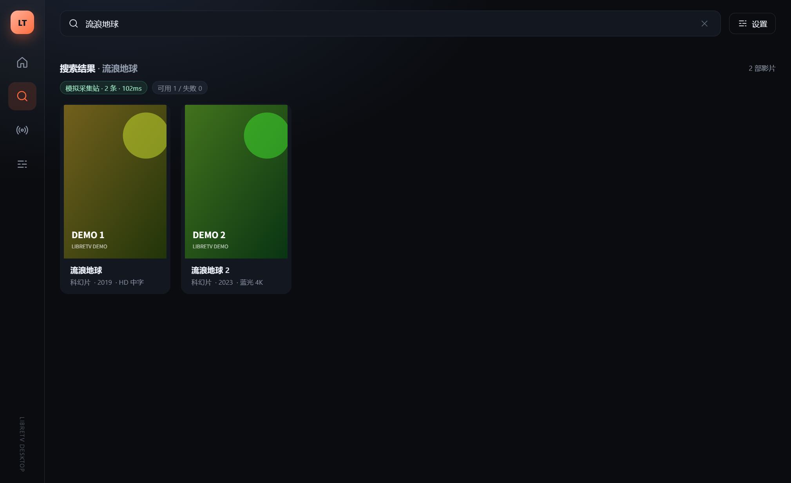
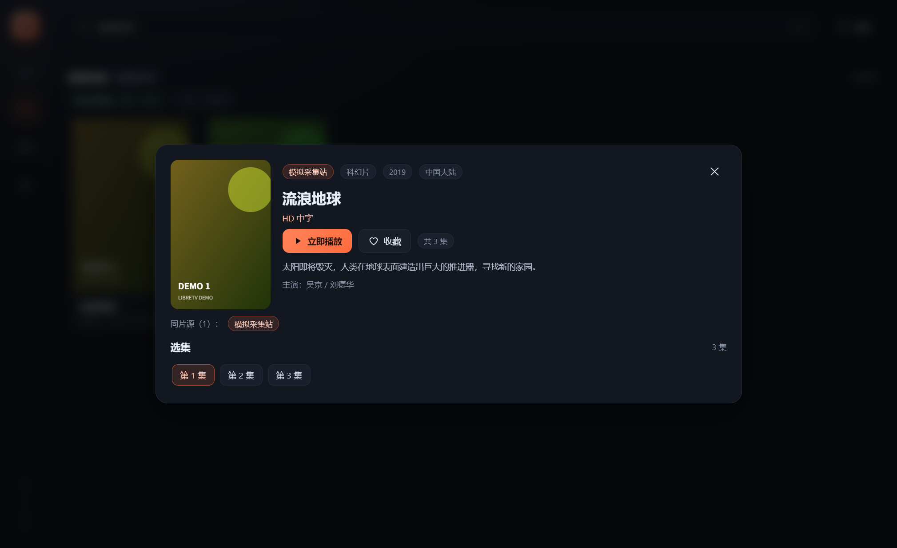
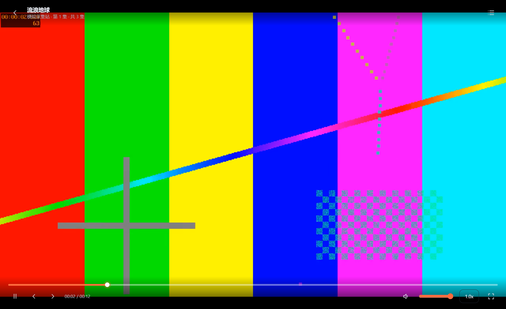
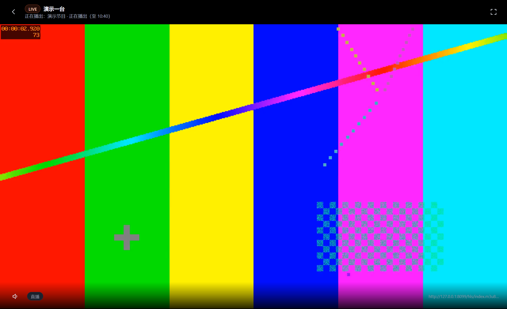
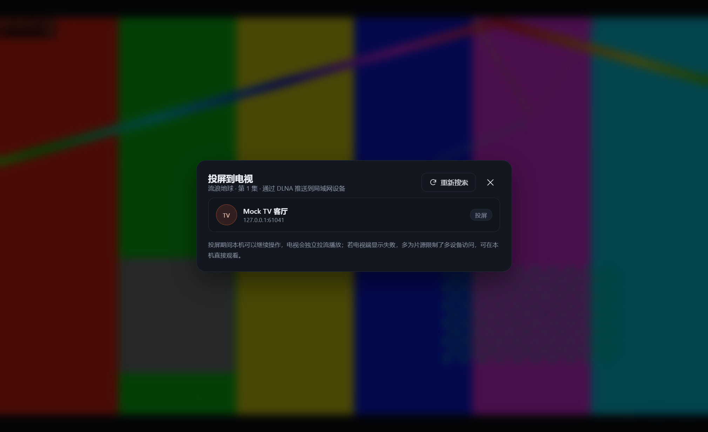

# LibreTV PC & Android TV 客户端

基于 [LibreSpark/LibreTV](https://github.com/LibreSpark/LibreTV) 的**桌面端（Windows / macOS / Linux）**与 **Android TV** 客户端。把上游 Next.js 服务端的采集聚合、解析与代理逻辑全部下放到客户端运行：**不需要部署服务器、不需要访问密码**，装好即用。



## 做了什么

上游 LibreTV 是一套「Next.js 服务端聚合 + 网页播放器」的影视聚合站：搜索、详情、代理、鉴权都在 `/api/*` 里，前端只是壳。本项目把这一层拆开重做：

| 上游服务端能力 | 本项目做法 |
| --- | --- |
| `/api/search` 多源并行聚合 | `packages/core` 纯函数，桌面端由主进程直连、TV 端由 OkHttp 直连 |
| `/api/detail` 详情 + 详情页兜底 | 同上，逻辑逐行移植并加了单测 |
| `/api/proxy`、`/api/live/stream` 反代 | 桌面端在主进程内起**仅监听 127.0.0.1 的媒体代理**（随机端口 + token）；TV 端 ExoPlayer 无 CORS，不需要 |
| `/api/auth` 密码 + 会话 | 删除：本地客户端没有服务端，也就没有鉴权面 |
| `/api/status`、`DEFAULT_*` 环境变量 | 改为应用内「设置 / 数据源订阅」 |
| IndexedDB 播放进度 | 桌面 localStorage（zustand）、TV DataStore |

两端共享同一套解析语义，但各自有原生播放内核与交互：桌面用 Electron + hls.js / mpegts.js，电视用 Kotlin + Media3 ExoPlayer + Compose。

## 功能

| 能力 | 桌面端 | Android TV |
| --- | --- | --- |
| **首页分类入口**（电影 / 电视剧 / 少儿 / 综艺 / 动漫 / 纪录片 / 短剧 / 体育） | ✅ 自动隐藏无内容的分类 | ✅ 同左，且焦点移上去即加载（不用按 OK） |
| **分类结果缓存**（切回上一个分类立刻出内容） | ✅ 5 分钟 | ✅ 5 分钟 |
| **首页横幅**（两栏布局，一屏内看到分类入口） | ✅ 92px | ✅ 152dp |
| 聚合搜索（多源并行、结果流式出现） | ✅ | ✅ |
| 同名影片跨源聚合 + 详情内换源 | ✅ | ✅ |
| **播放失败自动换源**（本集重试 2 次 → 切候选源 → 按片名补源） | ✅ 也可按 `S` 手动换 | ✅ 遥控器 `Menu` 键 |
| **播放性能调优**（代理分片流式直通、hls.js/ExoPlayer 缓冲参数、卡顿看门狗） | ✅ | ✅ |
| HLS / MP4 播放、倍速、快捷键 | ✅ | ✅ 遥控器方向键 |
| **分片完整性**（上游 gzip 时不再截断分片，消除偶发花屏/噪点） | ✅ | ✅ 不经过代理，无此问题 |
| 广告分片过滤（m3u8 `adjump` / 超短片头段） | ✅ | ⏳ 路线图 |
| 直播 / IPTV（M3U、分组、收藏） | ✅ | ✅ |
| **直播列表渐进加载**（缓存优先 + 边下边解析边显示，万级频道首屏 < 1.5 秒） | ✅ | ✅ |
| **直播换台** | ✅ `↑ / ↓` 换台、`M` 静音、`Esc` 退出 | ✅ 遥控器 `↑ / ↓ / ← / →`、`CH+ / CH-` |
| 观看进度续播 / 历史 / 收藏 | ✅ 同一片子跨源只留一条记录（同名不同年份不合并）| ✅ 同左 |
| 数据源管理、订阅导入（LibreTV / TVBOX）、导入导出 | ✅ | ✅ |
| **投屏** | ✅ DLNA **发送端**（把影片推到电视/盒子） | ✅ DLNA **接收端**（手机投到电视） |
| 内置默认源（点播 + iptv-org 直播） | ✅ 首次启动导入，可删除/恢复 | ✅ 同左（同一份 `defaults/sources.json`） |

### 桌面端

首页顶部就是分类入口（电影 / 电视剧 / 少儿 / 综艺 / 动漫 / 纪录片 / 短剧 / 体育），点进去直接按源站分类浏览，无需先想片名：



搜索 → 详情 → 播放全程键盘可操作（`Ctrl+F` 搜索、空格暂停、`←→` 快退快进、`F` 全屏、`M` 静音、`N` 下一集、`Esc` 返回）：

| 搜索 | 详情 |
| --- | --- |
|  |  |

| 播放 | 直播 |
| --- | --- |
|  |  |

投屏面板会自动 SSDP 搜索局域网内的 DLNA 渲染设备：



### Android TV

- 十尺屏排版（正文 15–16sp、卡片聚焦放大 + 橙色描边），遥控器 D-pad 全程可达
- **按分辨率自适应缩放**：以 960×540dp 为设计基准，按实际逻辑宽高取 `min(w/960, h/540)` 缩放整套 dp/sp。廉价 4K 盒子把 `densityDpi` 误报成 160（逻辑宽度 3840dp）时，界面会等比放大 4 倍，而不是缩在左上角
- 首页横幅左右两栏（152dp 高），首屏即可同时看到横幅与分类入口，不用先滚一屏
- 首页分类入口只显示**真正有内容**的分类（探测结果落 DataStore，冷启动不闪烁）
- 播放页把操作映射到遥控器：`OK` 播放/暂停、`←→` 快退/快进 10s、`↑` 选集、`返回` 退出
- 直播播放中 `↑ / ↓`（含 `← / →`、`CH+ / CH-`）直接换台，在当前分组/搜索结果内循环
- 作为 **DLNA 接收端（DMR）** 常驻：手机视频 App 的投屏列表里出现「LibreTV 电视」，选中即在电视播放
- 开机横幅、Leanback 启动器、`android.software.leanback` 声明齐全

## 仓库结构

```
defaults/sources.json        内置默认源（两端共用同一份）
packages/core/               共享 TS 核心：解析 / 聚合 / 订阅 / 存储模型 / 增量解析（187 项单测）
apps/desktop/                Electron 桌面端（main / preload / renderer）
apps/androidtv/              Android TV（Kotlin + Compose + Media3 + 自研 DLNA DMR）
tools/mock-cms/              本地假采集站（端到端联调 + 截图）
tools/mock-dlna/             假 DLNA 渲染器（投屏链路测试）
reference/LibreTV/           上游源码只读快照（2.19.7），见 reference/UPSTREAM.md
docs/                        分析与架构文档
```

## 快速开始

### 桌面端

```bash
npm install
npm run dev:desktop      # 开发模式（Electron + Vite HMR）
npm run build:desktop    # 产物构建到 apps/desktop/out
npm run dist:desktop     # 打包安装包（NSIS / portable / dmg / AppImage）
```

> Linux/macOS 上打包目标会自动切换；Windows 上默认产出 `release/LibreTV-*.exe`。
> 首次启动会自动导入 `defaults/sources.json` 里的默认源，可在「设置 → 点播源 / 直播源」里停用或删除，也可随时「恢复默认源」。

### Android TV

```bash
cd apps/androidtv
# 需 JDK 17–21、Android SDK 35、Gradle 8.13
gradle assembleDebug          # 或使用 Android Studio 打开该目录
adb connect <电视IP>:5555     # 电视开启「网络调试」
adb install -r app/build/outputs/apk/debug/app-debug.apk
```

APK 位置：`apps/androidtv/app/build/outputs/apk/debug/app-debug.apk`（debug 包名带 `.debug` 后缀）。

### 测试

```bash
npm test                     # 核心解析/聚合/换源/增量解析 + 桌面代理 187 项单测
npm run test:dlna            # DLNA 发送端链路（SSDP → 设备描述 → SOAP）
cd apps/androidtv && gradle testDebugUnitTest   # Kotlin 解析层/换源/缩放/换台/播放器参数/观看记录去重 73 项单测
```

端到端联调（本地假采集站 + 真实 HLS 视频）：见 [docs/build.md](docs/build.md#端到端联调)。

TV 端没有真机也能验：普通 `system-images;android-35;default;x86_64` 镜像 + `-d tv_1080p` 建出来的 AVD 能正常拉起 leanback Activity、D-pad 可用（`android-tv` 镜像下载失败时的替代方案，细节见 [docs/architecture.md](docs/architecture.md#本机验证-tv-端的方法)）。

真机验证脚本都在 `tools/e2e/`（CDP 驱动，桌面端需以 `--remote-debugging-port=9333` 启动）：

- `failover.mjs`：搜索 → 起播 → 按 `S` 手动换源 → 屏蔽当前 CDN 域名，确认播放器自动切到别的源并继续播放。
- `live.mjs`：记录直播列表从首次上屏到加载完成的频道数时间线 → 挑一个能播的频道起播 → 按 `↓` / `↑` 换台并确认台名变化。
- `resize.mjs`：用 CDP 覆盖视口宽度，量 `.field` 是否被压到横向滚动、`.hero` 高度、页面是否横向溢出（PC 最小窗口 1024×640 的布局回归）。
- `watch-categories.mjs`：冷启动后每 25ms 采样分类栏，只打印变化，用来抓「先显示 8 个、几秒后收敛」过程中的错误中间态。

## 关于内置源与内容

- 内置的点播源是**第三方公开 Apple CMS 接口**，直播源是 [iptv-org](https://github.com/iptv-org/iptv) 的公开 M3U 列表；它们与本项目**无隶属关系**，仅作为开箱即用的示例。
- 本项目**不存储、不制作、不分发**任何视频内容，只提供第三方公开接口的解析与播放能力；内容的合法性由对应数据源负责。
- 所有源都可以在设置里停用/删除，也可以完全手动添加自己的源或订阅。

## 文档

- [上游分析与「服务端 → 客户端」改造决策](docs/analysis.md)
- [架构设计（进程模型 / 播放链路 / 投屏链路）](docs/architecture.md)
- [构建、打包与联调指南](docs/build.md)

## 许可证

AGPL-3.0-or-later。上游 LibreTV 同许可，本仓库作为衍生作品同样以 AGPL 发布，详见 [LICENSE](LICENSE)。

应用图标沿用上游 LibreTV 的 artwork（`public/icons/icon-512.png`，AGPL-3.0-or-later）：桌面端侧栏品牌位、窗口/任务栏图标与安装包图标，Android TV 的启动图标与 Leanback 横幅均由这套 artwork 生成。
